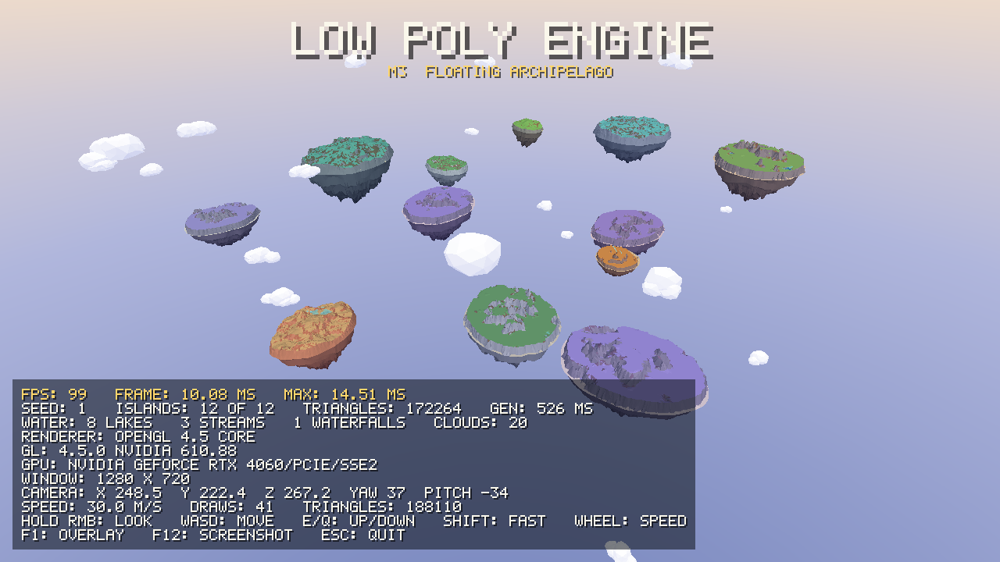
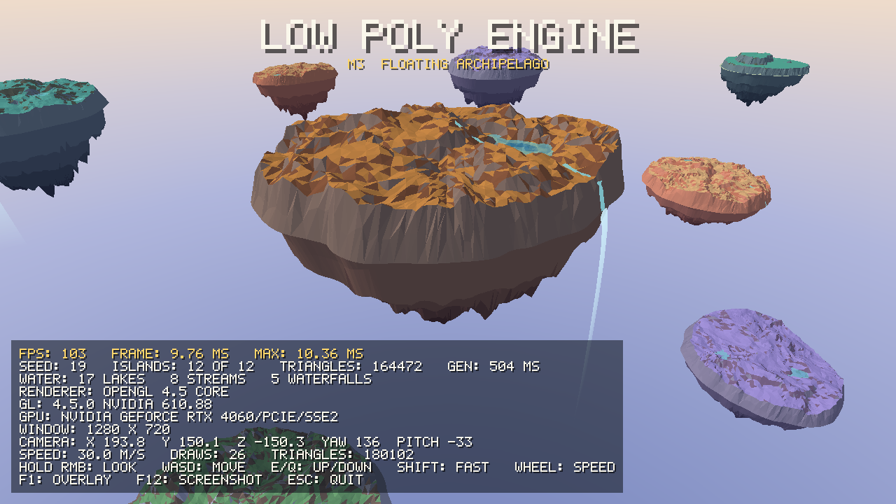

# LowPolyEngine

A C++20 low-poly 3D engine and editor with Lua gameplay scripting. Current stage: **M3 — procedural floating sky archipelago** is in progress on the branch `milestone/m3-floating-archipelago`: a seeded archipelago of floating islands at different altitudes, with rocky undersides, their own palettes, local water (lakes, streams, waterfalls) and low-poly clouds between them, in the art direction of *AER: Memories of Old* (plan and status of each step: `docs/milestones/m3-floating-archipelago.md`; so far island-preview generates and shows the floating islands — placement in 3D, shapes, closed flat-shaded meshes, palettes, local lakes, streams with ponds and waterfalls, drifting low-poly clouds — under a stylized sky; settings files and an editor panel come next). Done and merged into `main`: M0 (build, CI, SDL3 window, OpenGL 4.5 context), M1 (application loop, frame timing, keyboard/mouse input, free-fly camera, mesh rendering from CPU `MeshData`, debug overlay) and M2 (normals and UVs, PNG textures, materials with a base color and an optional texture, one directional light with flat shading, import of a documented OBJ subset; pull request #3). See `docs/ENGINE_PLAN.md` for the roadmap.





## Running the island preview

```powershell
scripts\windows\build.bat debug
scripts\windows\run.bat debug
```

| Input | Action |
|---|---|
| hold right mouse button + move | look around |
| W / A / S / D (or arrow keys) | fly forward / left / back / right |
| E or Space / Q or Ctrl | up / down |
| Shift | fly faster |
| mouse wheel | change flying speed |
| F1 | toggle the debug overlay |
| F12 | save a screenshot to `screenshots/` (ignored by Git) |
| Escape | quit |

Keys are physical positions, so WASD works on any keyboard layout. By default island-preview generates the archipelago of the default world settings (seed 1) and starts with a view over it; flying speed starts at 30 m/s. Command-line options: `island-preview [--frames N] [--assets DIR] [--screenshot FILE.png] [--seed N] [--island N] [--test-scene [--model FILE.obj]]`; `--screenshot` saves the last frame (frame 120 unless `--frames` is given) and exits; `--seed` generates another world; `--island N` starts with a close view of island N (from 0, in placement order), beside its waterfall if it has one; `--test-scene` shows the M1/M2 test scene instead, where `--model` loads another OBJ file instead of the lighthouse (used by tests). This is how the images in `docs/screenshots/` are made (ADR 0006).

## Building on Windows

### Requirements

| Tool | Version used | Notes |
|---|---|---|
| Visual Studio 2026 (MSVC 19.5x) | 18.x | "Desktop development with C++" workload. Ships CMake, Ninja, clang-format and clang-tidy. |
| CMake | ≥ 3.25 | The one bundled with Visual Studio works. |
| Python | 3.10+ | Only for the developer tools below. |
| Conan, clang-format | pinned in `requirements-dev.txt` | Installed into a local `.venv`, see below. CI uses the same versions. |

### First-time setup

```powershell
python -m venv .venv
.venv\Scripts\python -m pip install -r requirements-dev.txt
```

### Build and test with the scripts

Thin wrappers in `scripts/windows/` run the same commands as below. Each takes `debug` (default) or `release`; they work from any folder.

| Script | Does |
|---|---|
| `configure.bat [debug\|release]` | `conan install` + `cmake --preset` |
| `build.bat [debug\|release]` | configure, then `cmake --build --preset` |
| `test.bat [debug\|release] [gpu]` | `ctest --preset` on an existing build: headless tests, or with `gpu` only the rendering tests (need OpenGL 4.5) |
| `run.bat [debug\|release] [target]` | runs `build\<preset>\bin\<Config>\<target>.exe` from the repository root; default target `island-preview` (free-fly test scene) |
| `format-check.bat` | `clang-format --dry-run --Werror` on all C/C++ sources |
| `clean.bat [debug\|release\|all]` | deletes `build\windows-msvc-*` only (default: all) |

Conan and clang-format are taken from `.venv` first; other tools from `PATH`, then from the Visual Studio installation (CMake, clang-format).

### Build and test manually (Debug)

```powershell
.venv\Scripts\conan install . -pr:h=profiles/windows-msvc -pr:b=profiles/windows-msvc -s build_type=Debug --build=missing -of build/windows-msvc-debug/conan
cmake --preset windows-msvc-debug
cmake --build --preset windows-msvc-debug
ctest --preset windows-msvc-debug
```

For Release, replace `Debug` with `Release` and `windows-msvc-debug` with `windows-msvc-release`. Conan must run before CMake: it generates the toolchain file the preset points to.

Options: `-DLPE_BUILD_TESTS=OFF` skips tests; `-DLPE_WARNINGS_AS_ERRORS=ON` (or the environment variable `LPE_WARNINGS_AS_ERRORS=ON`, which CI sets) turns warnings into errors.

## Building on Linux

Supported baseline: Ubuntu 24.04 with GCC 13 (what CI uses). Ninja comes from `requirements-dev.txt`.

```bash
python3 -m venv .venv
.venv/bin/python -m pip install -r requirements-dev.txt
export PATH="$PWD/.venv/bin:$PATH"
conan install . -pr:h=profiles/linux-gcc -pr:b=profiles/linux-gcc -s build_type=Debug --build=missing -of build/linux-gcc-debug/conan
cmake --preset linux-gcc-debug
cmake --build --preset linux-gcc-debug
ctest --preset linux-gcc-debug
```

SDL needs X11 and OpenGL development packages (`libx11-dev`, `libgl-dev` and related). Conan only checks for them by default; add `-c tools.system.package_manager:mode=install -c tools.system.package_manager:sudo=True` to `conan install` to let it install them with apt (CI does this).

## Continuous integration

`.github/workflows/ci.yml` runs on every push and pull request: Windows MSVC (`windows-2025-vs2026` runner, through `scripts/windows/*.bat`) and Linux GCC 13 (`ubuntu-24.04`, the commands above), Debug and Release, with warnings as errors. The Windows Debug job also runs `format-check.bat`. CI runs the headless tiers only; the GPU tier (`test.bat <config> gpu` or the `*-gpu` test presets) is run locally.

## Development workflow

Full rules: `docs/DEVELOPMENT_WORKFLOW.md`. In short:

- Work in this one checkout with ordinary branches; no Git worktrees.
- `main` is the stable branch. Each milestone is developed on `milestone/mN-<name>` and merged into `main` through a pull request once the milestone is accepted.
- A milestone is split into numbered sub-milestones (`docs/milestones/`). One task implements exactly one of them, runs the checks in `docs/TESTING_AND_CI.md` §8, makes one commit `type(scope): summary (MN.x)`, pushes and waits for green CI, then marks the step done in the plan with a separate commit, reports and stops.
- Visible changes are recorded as engine-made screenshots in `docs/screenshots/mN/`.

## Repository layout

- `engine/` — engine library (`engine` CMake target), one folder per domain:
  - `app/` — application lifecycle and frame loop (`Application`, `run`).
  - `core/` — results, logging, frame clock, files, PNG images, math aliases (GLM).
  - `platform/` — window, OpenGL context, input; SDL3 only in `engine/src/platform/sdl3/`.
  - `geometry/` — CPU-side `MeshData`, primitive builders and OBJ subset import (ADR 0012); no GPU or SDL code.
  - `worldgen/` — deterministic world generation, pure CPU: seeded random numbers (ADR 0003), 2D noise (ADR 0003 Amendment 2), the validated world settings (ADR 0013), island placement in 3D (ADR 0013 Amendment 1), island shapes: outline, top surface and underside (ADR 0014), closed island meshes (ADR 0014 Amendment 1) and island palettes as vertex colours (ADR 0015), local water: lakes, streams with ponds and waterfalls (ADR 0016), clouds and their drift (ADR 0017), and whole archipelagos (ADR 0014 Amendment 2); no GPU, SDL or ImGui code.
  - `render/` — renderer API with mesh, texture and material handles and one directional light; OpenGL/GLAD only in `engine/src/render/opengl/`.
  - `camera/` — camera math and the free-fly controller.
  - `debug/` — built-in pixel font for on-screen diagnostics.
- `sandbox/island-preview/` — first executable: the generated floating archipelago with its translucent local water and drifting clouds under a sky dome (default) or, with `--test-scene`, the lit, partly textured M1/M2 test scene with an imported model; free-fly camera and debug overlay (see above; `assets/` is found relative to the working directory).
- `assets/shaders/` — GLSL sources loaded at runtime.
- `assets/textures/` — textures of the test scene (PNG, made for the project; origin in `docs/references/THIRD_PARTY_NOTICES.md`).
- `assets/models/` — models of the test scene (OBJ subset, ADR 0012; made for the project). A missing or broken asset is logged and the rest of the scene runs.
- `tests/` — Catch2/CTest tiers: `unit/` (headless), `integration/` (SDL dummy video driver, headless), `rendering/` (label `gpu`, real OpenGL, frame readback).
- `docs/screenshots/` — captured screenshots per milestone, with how they were made.
- `third_party/glad/` — generated OpenGL loader; regenerate with `scripts/python/generate_glad.py` (ADR 0005).
- `third_party/stb_image_write/` — compiles the stb PNG writer (header from Conan) without project warning flags (ADR 0006).
- `third_party/stb_image/` — compiles the stb PNG decoder the same way, PNG only (ADR 0008).
- `cmake/` — shared CMake modules (warning policy).
- `profiles/` — Conan profiles.
- `docs/` — plan, tech stack, structure, testing strategy, development workflow, ADRs; `docs/milestones/` holds the step-by-step plan of each milestone.
- `CLAUDE.md`, `AGENTS.md`, `.claude/skills/engine-dev/` — instructions for AI-assisted development.
