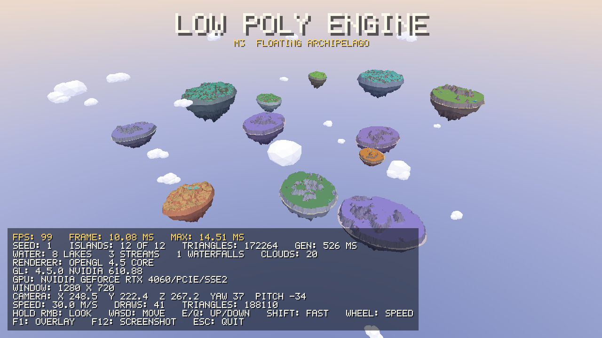
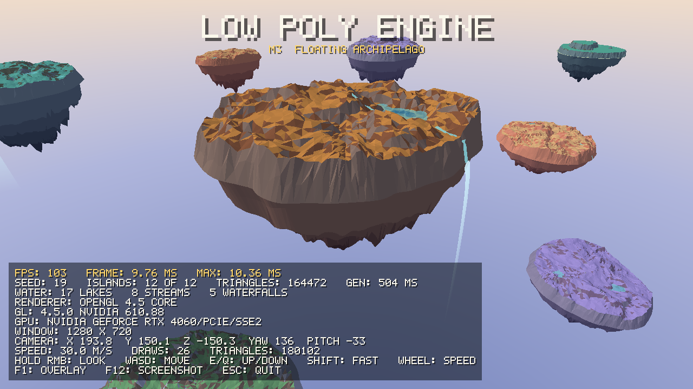
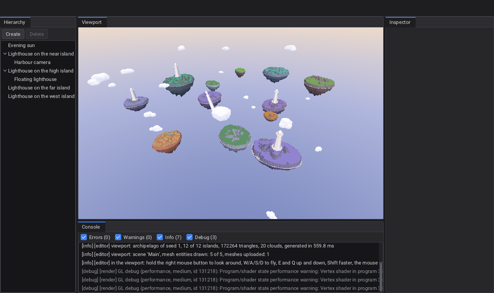

# LowPolyEngine

A C++20 low-poly 3D engine and editor with Lua gameplay scripting. Current stage: **M5 — minimal editor** is in progress on the branch `milestone/m5-minimal-editor` (`docs/milestones/m5-minimal-editor.md`). In place: M5.1, Raven as a pinned dependency (vendored in `third_party/raven/`, built offline, tested headless); M5.2, Raven hosted by the engine on its SDL3 window and OpenGL context, with `lpe-editor` opening the editor shell (ADR 0027; `docs/screenshots/m5/001-editor-shell.png`); M5.3, the generated archipelago under its sky in the editor's viewport with a free-fly camera (`engine/world/`, shared with island-preview; `docs/screenshots/m5/002-world-viewport.png`); M5.4, a project folder (`project.json` naming the asset manifest, the start scene and the world settings) created, opened all or nothing and saved as a whole, so a failed save never leaves a mixture of old and new files (`engine/project/`, ADR 0028; no UI yet); M5.5, the editor's document with undoable commands for every change of the scene and the world settings, merged continuous edits, a dirty state against the last save and a selection (`editor/include/editor/`, ADR 0029; no UI yet); M5.6, `lpe-editor <project folder>` opening a project and drawing its scene's entities with static meshes in the viewport, inside the generated world, following every change of the document (`engine/world/`'s scene view; the test project `tests/projects/lighthouses/`; `docs/screenshots/m5/003-scene-entities.png`); and M5.7, the hierarchy, a tree of the scene's entities that creates, deletes, renames in place and reparents by dragging, each action one undoable command, and the console with the engine's log, filtered by level, through a new log listener in `engine/core` (ADR 0030; `docs/screenshots/m5/004-hierarchy-console.png`). The milestone as a whole: a separate editor program with a viewport, hierarchy, inspector, WorldGen panel, console, undo and redo, and project files, on Raven (ADR 0019, accepted after an evaluation and a final validation on Windows and Linux: `docs/experiments/raven-ui-evaluation.md`, `docs/experiments/raven-final-validation.md`); Dear ImGui stays the debug UI. Done and merged into `main`: **M4 — scene document and data model** (pull request #5, `1425c2c`; plan, status and verification of each step: `docs/milestones/m4-scene-data-model.md`): entities with persistent IDs and components stored in EnTT (M4.1, M4.2), persistent asset IDs with portable project-relative paths, an asset registry and manifest, and static mesh components (M4.3), scenes saved and loaded as versioned JSON documents (M4.4), sandboxed Lua scripts that move entities through a small engine API with every error contained, and a Conan lockfile (M4.5), parent links and prefabs saved as documents and instantiated into scenes (M4.6), and an end-to-end check of all of it (M4.7); M4 adds no rendering of scenes and no editor UI. Also done and merged into `main`: **M3 — procedural floating sky archipelago** (pull request #4, `0befa66`): a seeded archipelago of floating islands at different altitudes, with rocky undersides, their own palettes, local water (lakes, streams, waterfalls) and low-poly clouds between them, in the art direction of *AER: Memories of Old* (plan, status and verification of each step: `docs/milestones/m3-floating-archipelago.md`; island-preview generates and shows the floating islands — placement in 3D, shapes, closed flat-shaded meshes, palettes, local lakes, streams with ponds and waterfalls, drifting low-poly clouds — under a stylized sky, saves and loads world settings as versioned JSON, and edits them in a Dear ImGui panel that regenerates the world in place; screenshots of several seeds: `docs/screenshots/m3/`). Earlier, also merged: M0 (build, CI, SDL3 window, OpenGL 4.5 context), M1 (application loop, frame timing, keyboard/mouse input, free-fly camera, mesh rendering from CPU `MeshData`, debug overlay) and M2 (normals and UVs, PNG textures, materials with a base color and an optional texture, one directional light with flat shading, import of a documented OBJ subset; pull request #3). See `docs/ENGINE_PLAN.md` for the roadmap.





## Running the island preview

```powershell
scripts\windows\build.bat debug
scripts\windows\run.bat debug
```

| Input | Action |
|---|---|
| hold right mouse button + move | look around |
| W / A / S / D (or arrow keys) | fly forward / left / back / right |
| E or Space / Q or Ctrl | up / down |
| Shift | fly faster |
| mouse wheel | change flying speed |
| F1 | toggle the debug overlay |
| F2 | show or hide the WorldGen panel (Dear ImGui): edit every world setting, Regenerate the world in place, save and load settings files |
| F12 | save a screenshot to `screenshots/` (ignored by Git) |
| Escape | quit |

Keys are physical positions, so WASD works on any keyboard layout. By default island-preview generates the archipelago of the default world settings (seed 1) and starts with a view over it; flying speed starts at 30 m/s. Command-line options: `island-preview [--frames N] [--assets DIR] [--screenshot FILE.png] [--seed N] [--island N] [--settings FILE.json] [--save-settings FILE.json] [--panel] [--test-scene [--model FILE.obj]]`; `--screenshot` saves the last frame (frame 120 unless `--frames` is given) and exits; `--seed` generates another world; `--island N` starts with a close view of island N (from 0, in placement order), beside its waterfall if it has one; `--settings FILE.json` starts from a world settings file (`assets/worlds/default.json` holds the defaults; `--seed` replaces its seed), `--save-settings FILE.json` writes the settings in use; `--panel` opens the WorldGen panel at the start; `--test-scene` shows the M1/M2 test scene instead, where `--model` loads another OBJ file instead of the lighthouse (used by tests). This is how the images in `docs/screenshots/` are made (ADR 0006).

## Running the editor

`lpe-editor` (M5, `editor/`) is the editor on Raven (ADR 0019, ADR 0027). It opens the editor shell: a toolbar, the viewport, the hierarchy, the inspector and the console, laid out by Raven and drawn through the engine's OpenGL backend (M5.2). The viewport shows the archipelago under its sky, drawn by the engine's renderer inside Raven's frame (M5.3). Given a project folder, the editor opens the project and the viewport shows its world settings and its scene's entities with a static mesh (M5.6); without one, the default world. The hierarchy lists the scene's entities, children under their parents, and the console shows the run's log (M5.7); the inspector gets its content in M5.8. Run it from the repository root (the renderer reads `assets/shaders`), for example with the test project:

```powershell
build\windows-msvc-debug\bin\Debug\lpe-editor.exe tests\projects\lighthouses
```

The camera in the viewport flies like island-preview's. The viewport has the keyboard at the start; a click in it gives the keyboard back after another area took it.

| Input (in the viewport) | Action |
|---|---|
| Hold right mouse button + move | look around |
| W / A / S / D | move forward / left / back / right |
| E / Q | move up / down |
| Shift | move faster (4x) |
| Mouse wheel | change flying speed (starts at 30 m/s) |

The hierarchy (M5.7) changes the scene through the editor's document, each action one undo step (undo and redo have no keys or buttons yet):

| Input (in the hierarchy) | Action |
|---|---|
| Create | a new entity named "Entity" at the top level, with a transform at the defaults, selected |
| Delete, or the Delete key | deletes the selected entity; its children move to the top level |
| F2, Enter or a double click | renames the entity in place: Enter or a click elsewhere renames, Escape cancels |
| Drag onto an entity / below the rows | makes it that entity's child / puts it at the top level |
| Click, arrow keys | select (the same selection as the rest of the editor); Left and Right close and open a branch |

A change the scene refuses (an empty name, a parent link that would make a cycle) changes nothing, and its message appears in the console as a warning. The console's checkboxes show or hide each level's lines and count them; warnings are amber, errors red, debug lines dimmed.

Command line: `lpe-editor [PROJECT_FOLDER] [--frames N] [--screenshot FILE.png] [--size WIDTHxHEIGHT]`. The project folder holds `project.json` (M5.4, ADR 0028); a folder that does not open as a project stops the editor with the error and exit code 1. Without `--frames` the window stays open until it is closed. `--screenshot` saves the last frame, made by the editor itself (frame 30 unless `--frames` is given), and exits. `--size` sets the window's size (default 1280x760). An unknown argument or an invalid value prints the usage line and exits with code 2. The exit code is 3 for OpenGL errors, 4 for a failed screenshot, and 5 if Raven left OpenGL state changed, reported errors or kept memory after shutdown.



## Building on Windows

### Requirements

| Tool | Version used | Notes |
|---|---|---|
| Visual Studio 2026 (MSVC 19.5x) | 18.x | "Desktop development with C++" workload. Ships CMake, Ninja, clang-format and clang-tidy. |
| CMake | ≥ 3.25 | The one bundled with Visual Studio works. |
| Python | 3.10+ | Only for the developer tools below. |
| Conan, clang-format | pinned in `requirements-dev.txt` | Installed into a local `.venv`, see below. CI uses the same versions. |

### First-time setup

```powershell
python -m venv .venv
.venv\Scripts\python -m pip install -r requirements-dev.txt
```

### Build and test with the scripts

Thin wrappers in `scripts/windows/` run the same commands as below. Each takes `debug` (default) or `release`; they work from any folder.

| Script | Does |
|---|---|
| `configure.bat [debug\|release]` | `conan install` + `cmake --preset` |
| `build.bat [debug\|release]` | configure, then `cmake --build --preset` |
| `test.bat [debug\|release] [gpu]` | `ctest --preset` on an existing build: headless tests, or with `gpu` only the rendering tests (need OpenGL 4.5) |
| `run.bat [debug\|release] [target]` | runs `build\<preset>\bin\<Config>\<target>.exe` from the repository root; default target `island-preview` (free-fly test scene) |
| `format-check.bat` | `clang-format --dry-run --Werror` on all C/C++ sources |
| `clean.bat [debug\|release\|all]` | deletes `build\windows-msvc-*` only (default: all) |

Conan and clang-format are taken from `.venv` first; other tools from `PATH`, then from the Visual Studio installation (CMake, clang-format).

### Build and test manually (Debug)

```powershell
.venv\Scripts\conan install . -pr:h=profiles/windows-msvc -pr:b=profiles/windows-msvc -s build_type=Debug --lockfile=conan.lock --build=missing -of build/windows-msvc-debug/conan
cmake --preset windows-msvc-debug
cmake --build --preset windows-msvc-debug
ctest --preset windows-msvc-debug
```

For Release, replace `Debug` with `Release` and `windows-msvc-debug` with `windows-msvc-release`. Conan must run before CMake: it generates the toolchain file the preset points to.

`conan.lock` pins every package version and recipe revision for both the Windows and the Linux profile (ADR 0024); `conan install` fails if `conanfile.py` asks for something the lockfile does not hold. After changing a requirement, create the lockfile again for all four configurations:

```powershell
.venv\Scripts\conan lock create . -pr:h=profiles/windows-msvc -pr:b=profiles/windows-msvc -s build_type=Debug --lockfile-out=conan.lock
.venv\Scripts\conan lock create . -pr:h=profiles/windows-msvc -pr:b=profiles/windows-msvc -s build_type=Release --lockfile=conan.lock --lockfile-out=conan.lock
.venv\Scripts\conan lock create . -pr:h=profiles/linux-gcc -pr:b=profiles/linux-gcc -s build_type=Debug --lockfile=conan.lock --lockfile-out=conan.lock
.venv\Scripts\conan lock create . -pr:h=profiles/linux-gcc -pr:b=profiles/linux-gcc -s build_type=Release --lockfile=conan.lock --lockfile-out=conan.lock
```

The first command starts a new lockfile; the others add what each configuration needs (the Linux profile also needs `xorg/system`, `pkgconf`, `meson` and `ninja`). Conan computes the Linux graph on Windows too; nothing is built.

Options: `-DLPE_BUILD_TESTS=OFF` skips tests; `-DLPE_WARNINGS_AS_ERRORS=ON` (or the environment variable `LPE_WARNINGS_AS_ERRORS=ON`, which CI sets) turns warnings into errors.

## Building on Linux

Supported baseline: Ubuntu 24.04 with GCC 13 (what CI uses). Ninja comes from `requirements-dev.txt`.

```bash
python3 -m venv .venv
.venv/bin/python -m pip install -r requirements-dev.txt
export PATH="$PWD/.venv/bin:$PATH"
conan install . -pr:h=profiles/linux-gcc -pr:b=profiles/linux-gcc -s build_type=Debug --lockfile=conan.lock --build=missing -of build/linux-gcc-debug/conan
cmake --preset linux-gcc-debug
cmake --build --preset linux-gcc-debug
ctest --preset linux-gcc-debug
```

SDL needs X11 and OpenGL development packages (`libx11-dev`, `libgl-dev` and related). Conan only checks for them by default; add `-c tools.system.package_manager:mode=install -c tools.system.package_manager:sudo=True` to `conan install` to let it install them with apt (CI does this).

## Continuous integration

`.github/workflows/ci.yml` runs on every push and pull request: Windows MSVC (`windows-2025-vs2026` runner, through `scripts/windows/*.bat`) and Linux GCC 13 (`ubuntu-24.04`, the commands above), Debug and Release, with warnings as errors. The Windows Debug job also runs `format-check.bat`. From M5.2 the Linux jobs also run the GPU tier and `lpe-editor` (at 100 % and 150 %) on software OpenGL: Xvfb with Mesa's llvmpipe, no GPU. That is not a test on graphics hardware; the GPU tier on hardware (`test.bat <config> gpu` or the `*-gpu` test presets) is run locally.

## Development workflow

Full rules: `docs/DEVELOPMENT_WORKFLOW.md`. In short:

- Work in this one checkout with ordinary branches; no Git worktrees.
- `main` is the stable branch. Each milestone is developed on `milestone/mN-<name>` and merged into `main` through a pull request once the milestone is accepted.
- A milestone is split into numbered sub-milestones (`docs/milestones/`). One task implements exactly one of them, runs the checks in `docs/TESTING_AND_CI.md` §8, makes one commit `type(scope): summary (MN.x)`, pushes and waits for green CI, then marks the step done in the plan with a separate commit, reports and stops.
- Visible changes are recorded as engine-made screenshots in `docs/screenshots/mN/`.

## Repository layout

- `engine/` — engine library (`engine` CMake target), one folder per domain:
  - `app/` — application lifecycle and frame loop (`Application`, `run`).
  - `core/` — results, logging (with listeners, ADR 0030), frame clock, files (with atomic replacement), PNG images, math aliases (GLM), persistent 128-bit IDs and their generator (ADR 0020), UTF-8 checks.
  - `scene/` — the scene model (M4): entity and scene IDs and the scene core that creates, finds and destroys entities by ID (M4.1); validated name, transform, camera and directional light components, stored in EnTT inside `src/scene/Scene.cpp` only (M4.2); the static mesh component with mesh and material asset IDs and the check of a scene's asset references (M4.3); scene documents as versioned JSON, saved atomically and loaded all or nothing (M4.4, ADR 0023); the script component (M4.5); parent links, prefabs, prefab documents and instantiation (M4.6, ADR 0025); no GPU, SDL or ImGui code.
  - `scripting/` — the Lua script runtime (M4.5, ADR 0024): one sandboxed Lua 5.5 VM with an instruction budget and a memory limit, scripts with `start` and `update` that read and move entities through the `engine` table; Lua only in `src/scripting/lua/`, no Lua type in public headers.
  - `assets/` — asset identity (M4.3, ADR 0022): asset IDs and types, portable project-relative asset paths, the asset registry (types, paths, letter-case conflicts, files present or missing) and the asset manifest as versioned JSON; loads no files and holds no GPU resources.
  - `platform/` — window, OpenGL context, input; SDL3 only in `engine/src/platform/sdl3/`.
  - `geometry/` — CPU-side `MeshData`, primitive builders and OBJ subset import (ADR 0012); no GPU or SDL code.
  - `worldgen/` — deterministic world generation, pure CPU: seeded random numbers (ADR 0003), 2D noise (ADR 0003 Amendment 2), the validated world settings (ADR 0013), island placement in 3D (ADR 0013 Amendment 1), island shapes: outline, top surface and underside (ADR 0014), closed island meshes (ADR 0014 Amendment 1) and island palettes as vertex colours (ADR 0015), local water: lakes, streams with ponds and waterfalls (ADR 0016), clouds and their drift (ADR 0017), whole archipelagos (ADR 0014 Amendment 2) and settings files as versioned JSON (ADR 0004 Amendment 1); no GPU, SDL or ImGui code.
  - `render/` — renderer API with mesh, texture and material handles and one directional light; OpenGL/GLAD only in `engine/src/render/opengl/`.
  - `camera/` — camera math and the free-fly controller.
  - `debug/` — built-in pixel font for on-screen diagnostics, and the Dear ImGui debug UI (`DebugUi`, ADR 0018; its SDL3 and OpenGL 3 backends only in the platform and renderer folders).
  - `ui/` — the Raven UI an application turns on with `ApplicationDesc::ui` (M5.2, ADR 0027): one owner of Raven's state in `src/ui/`, Raven's OpenGL backend in `src/render/opengl/`, its SDL3 host bridge in `src/platform/sdl3/`; no Raven, SDL or OpenGL type in the public header.
  - `project/` — a project folder (`project.json`, the asset manifest, the start scene, the world settings): created, opened all or nothing and saved consistently as a whole through a save journal (M5.4, ADR 0028); no editor, UI, window or renderer code, so a runtime application can open it too.
  - `world/` — the generated world on the GPU (`WorldScene`: islands, water and clouds through the renderer's API), the sky dome, the archipelago's sunlight and overview camera; moved from island-preview in M5.3, used by it and by the editor's viewport. A scene's entities for the renderer (M5.6): which are drawn with which matrices and light (`SceneDraws`), mesh assets read once (`MeshAssets`), uploaded once and drawn (`SceneView`).
- `sandbox/island-preview/` — first executable: the generated floating archipelago with its translucent local water and drifting clouds under a sky dome (default) or, with `--test-scene`, the lit, partly textured M1/M2 test scene with an imported model; free-fly camera and debug overlay (see above; `assets/` is found relative to the working directory).
- `editor/` — the editor (M5): library `editor` and program `lpe-editor`, on Raven only (ADR 0019, ADR 0027); its Raven layouts in `editor/layouts/` are embedded at build time; the viewport's world and camera in `editor/src/viewport/`; the hierarchy and console panels in `editor/src/panels/` (M5.7); the UI-free document, its undoable commands and the selection in `editor/include/editor/` (ADR 0029), with the panels' UI-free models in `editor/include/editor/panels/`.
- `assets/shaders/` — GLSL sources loaded at runtime.
- `assets/textures/` — textures of the test scene (PNG, made for the project; origin in `docs/references/THIRD_PARTY_NOTICES.md`).
- `assets/worlds/` — world generation settings files (`default.json`, ADR 0004).
- `assets/models/` — models of the test scene (OBJ subset, ADR 0012; made for the project). A missing or broken asset is logged and the rest of the scene runs.
- `tests/` — Catch2/CTest tiers: `unit/` (headless), `integration/` (SDL dummy video driver, headless), `rendering/` (label `gpu`, real OpenGL, frame readback); `projects/` holds committed test projects (M5.6: `lighthouses/`).
- `docs/screenshots/` — captured screenshots per milestone, with how they were made.
- `third_party/glad/` — generated OpenGL loader; regenerate with `scripts/python/generate_glad.py` (ADR 0005).
- `third_party/imgui_backends/` — builds Dear ImGui's SDL3 and OpenGL 3 backends from the sources in the Conan `imgui` package (ADR 0018).
- `third_party/stb_image_write/` — compiles the stb PNG writer (header from Conan) without project warning flags (ADR 0006).
- `third_party/stb_image/` — compiles the stb PNG decoder the same way, PNG only (ADR 0008).
- `third_party/raven/` — Raven 0.2.3, the editor's UI library, as pruned vendored source with its licences; built as the static C library `raven` by `cmake/RavenDependency.cmake` (ADR 0026). Its `README.md` lists what is kept and removed, the one local change and how to update it.
- `cmake/` — shared CMake modules (warning policy; Raven's configuration and pin, `RavenDependency.cmake`; files embedded into the build, `EmbedFiles.cmake`).
- `profiles/` — Conan profiles.
- `docs/` — plan, tech stack, structure, testing strategy, development workflow, ADRs; `docs/milestones/` holds the step-by-step plan of each milestone, `docs/experiments/` the plans and reports of technical experiments outside the milestones (the Raven UI evaluation).
- `CLAUDE.md`, `AGENTS.md`, `.claude/skills/engine-dev/` — instructions for AI-assisted development.
